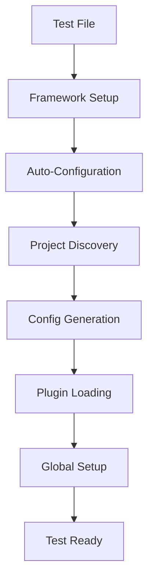
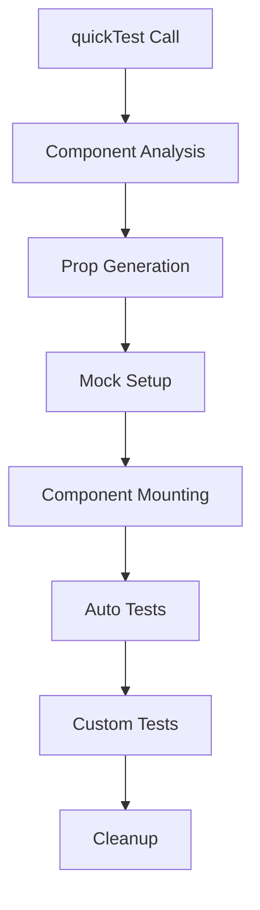
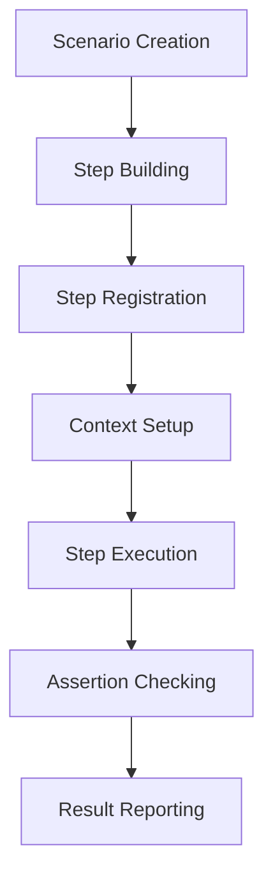

# Framework Architecture

## Overview

The BDD + Nuxt 4 Testing Micro-Framework is built with a modular architecture that provides maximum functionality with minimal configuration. The framework achieves 80% boilerplate reduction through intelligent automation and convention-over-configuration principles.

## High-Level Architecture

```
┌─────────────────────────────────────────────────────────────┐
│                    Framework Core                           │
├─────────────────────────────────────────────────────────────┤
│  Auto-Config Engine  │  Plugin System  │  Context Manager  │
├─────────────────────────────────────────────────────────────┤
│          Component Layer          │       BDD Layer        │
├─────────────────────────────────────────────────────────────┤
│     API Mock Layer    │  Integration Layer │ Utility Layer │
├─────────────────────────────────────────────────────────────┤
│                   Nuxt 4 Integration                       │
├─────────────────────────────────────────────────────────────┤
│                  Vitest Test Runner                        │
└─────────────────────────────────────────────────────────────┘
```

## Core Components

### 1. Framework Core (`/tests/framework/index.js`)

The main orchestrator that initializes and coordinates all framework components.

**Key Responsibilities:**
- Framework initialization and lifecycle management
- Plugin loading and management
- Configuration merging and validation
- Global helper setup

```javascript
export class BDDFramework {
  constructor(options = {}) {
    this.options = options
    this.initialized = false
    this.autoConfig = null
    this.nuxtBridge = null
    this.scenarios = new Map()
    this.plugins = new Map()
  }

  async initialize() {
    await this.setupAutoConfiguration()
    await this.setupNuxtIntegration()
    await this.setupCucumberIntegration()
    await this.loadPlugins()
    this.setupGlobalHelpers()
  }
}
```

### 2. Auto-Configuration Engine (`/tests/framework/config/`)

Automatically detects project structure and generates optimal configuration.

**Components:**
- `auto-discovery.js` - Scans project files and structure
- `smart-defaults.js` - Generates intelligent defaults
- `presets.js` - Applies configuration presets
- `zero-config.js` - Provides zero-configuration setup

**Discovery Process:**
```javascript
// Project structure analysis
const structure = {
  hasNuxt: checkForNuxtConfig(),
  hasTypeScript: checkForTSConfig(),
  hasVuex: checkForVuexStore(),
  hasPinia: checkForPiniaStore(),
  components: discoverComponents(),
  pages: discoverPages(),
  composables: discoverComposables()
}

// Smart defaults generation
const config = generateConfigFromStructure(structure)
```

### 3. Component Testing Layer (`/tests/framework/components/`)

Handles component mounting, prop generation, and testing utilities.

**Key Files:**
- `quick-test.js` - One-liner component testing
- `prop-validators.js` - Smart prop generation and validation
- `event-helpers.js` - Event testing utilities
- `a11y-helpers.js` - Accessibility testing
- `composable-testers.js` - Composable testing helpers

**QuickTest Architecture:**
```javascript
export const quickTest = (name, component, options = {}) => {
  return describe(name, () => {
    let wrapper
    let mockNuxt

    beforeEach(async () => {
      // Auto-generate props
      const autoProps = generateSmartProps(component)
      
      // Setup Nuxt mocks
      mockNuxt = createNuxtMocks()
      
      // Mount component
      wrapper = mount(component, {
        props: { ...autoProps, ...options.props },
        global: { mocks: mockNuxt }
      })
    })

    // Auto-generated tests
    it('renders without errors', () => {
      expect(wrapper.exists()).toBe(true)
    })
    
    // Additional tests based on options
    if (options.a11y) generateA11yTests()
    if (options.events) generateEventTests()
  })
}
```

### 4. BDD Layer (`/tests/framework/bdd/`)

Provides natural language testing capabilities with step generation.

**Components:**
- `step-generators.js` - Auto-generates step definitions
- `component-steps.js` - Component-specific step patterns
- `navigation-steps.js` - Navigation and routing steps
- `api-steps.js` - API interaction steps
- `auth-steps.js` - Authentication flow steps

**Fluent API Architecture:**
```javascript
export class ScenarioBuilder {
  constructor(description) {
    this.description = description
    this.steps = []
    this.context = createTestContext()
  }

  // Fluent API methods
  get given() {
    return new StepBuilder('given', this)
  }

  get when() {
    return new StepBuilder('when', this)
  }

  get then() {
    return new StepBuilder('then', this)
  }

  async execute() {
    for (const step of this.steps) {
      await this.executeStep(step)
    }
  }
}
```

### 5. API Mock Layer (`/tests/framework/api/`)

Intelligent API mocking with OpenAPI schema integration.

**Key Features:**
- Smart response generation
- Request/response validation
- Scenario-based mocking
- Record and playback functionality

**Smart Mock Architecture:**
```javascript
export class SmartMockSystem {
  constructor(config) {
    this.mocks = new Map()
    this.interceptors = []
    this.requestHistory = []
    this.activeScenario = 'default'
  }

  mock(method, path, response, options = {}) {
    // Store mock with priority and scenario support
    const mockDefinition = {
      method: method.toLowerCase(),
      path,
      response: typeof response === 'function' ? response : () => response,
      options
    }
    
    this.mocks.set(this.createMockKey(method, path), mockDefinition)
  }

  async handleRequest(req) {
    // Find matching mock
    const mock = this.findMatchingMock(req)
    
    // Validate if strict mode enabled
    if (this.strictValidation) {
      await this.validateRequest(req)
    }
    
    // Generate response
    return await mock.response(req)
  }
}
```

### 6. Integration Layer (`/tests/framework/integration/`)

Bridges the framework with external tools and environments.

**Integrations:**
- `nuxt-bridge.js` - Nuxt 4 integration and mocking
- `cucumber-bridge.js` - Cucumber.js compatibility
- `vitest-integration.js` - Vitest-specific enhancements

**Nuxt Bridge Architecture:**
```javascript
export class NuxtBridge {
  constructor(options) {
    this.options = options
    this.componentMocks = new Map()
    this.composableMocks = new Map()
  }

  enhanceScenario(scenario) {
    // Add Nuxt-specific step builders
    scenario.nuxt = {
      navigateTo: (path) => this.handleNavigation(path),
      mockComposable: (name, mock) => this.mockComposable(name, mock)
    }
  }

  createComponentMocks() {
    return {
      NuxtLink: { template: '<a @click="navigate"><slot /></a>' },
      NuxtPage: { template: '<div class="nuxt-page"><slot /></div>' },
      ClientOnly: { template: '<div><slot /></div>' }
    }
  }
}
```

## Data Flow Architecture

### 1. Test Initialization Flow



### 2. Component Testing Flow



### 3. BDD Scenario Flow



## Plugin System Architecture

### Plugin Interface

```javascript
export function createPlugin(name, install, cleanup) {
  return {
    name,
    version: '1.0.0',
    install: async (framework) => {
      // Plugin initialization logic
      await install(framework)
    },
    cleanup: async () => {
      // Plugin cleanup logic
      if (cleanup) await cleanup()
    }
  }
}
```

### Built-in Plugins

```javascript
// Authentication plugin
export const authPlugin = createPlugin('auth', (framework) => {
  ScenarioBuilder.prototype.auth = function() {
    return {
      login: (credentials) => this.performLogin(credentials),
      logout: () => this.performLogout(),
      isAuthenticated: () => this.checkAuthStatus()
    }
  }
})

// API plugin
export const apiPlugin = createPlugin('api', (framework) => {
  ScenarioBuilder.prototype.api = function() {
    return {
      request: (method, url, data) => this.makeApiRequest(method, url, data),
      mock: (method, url, response) => this.mockApiEndpoint(method, url, response)
    }
  }
})
```

## Context Management Architecture

### Test Context System

```javascript
export function createTestContext() {
  return {
    wrapper: () => wrapper,
    state: {},
    
    // Component lifecycle
    async setupComponent(component, options) {
      wrapper = mount(component, options)
      await nextTick()
      return wrapper
    },
    
    cleanupComponent() {
      if (wrapper) {
        wrapper.unmount()
        wrapper = null
      }
    },
    
    // Step execution
    async executeStep(stepText, ...args) {
      const stepFn = findStepDefinition(stepText)
      return await stepFn.call(this, ...args)
    }
  }
}
```

### Context Sharing

```javascript
// Global context for step definitions
export const globalContext = createTestContext()

// Step definitions bind to context
Given('I am on the {string} page', async function(pageName) {
  // 'this' refers to the test context
  await this.visit(`/${pageName}`)
})
```

## Performance Optimizations

### 1. Lazy Loading

```javascript
// Components loaded on demand
const loadComponent = memoize(async (path) => {
  return await import(path)
})

// Step definitions loaded when needed
const loadStepDefinitions = memoize(async (category) => {
  return await import(`./steps/${category}.steps.js`)
})
```

### 2. Caching System

```javascript
// Configuration caching
const configCache = new Map()

// Component mock caching
const mockCache = new WeakMap()

// Step definition caching
const stepCache = new Map()
```

### 3. Selective Execution

```javascript
// Only run relevant tests
const shouldRunTest = (testPath, changedFiles) => {
  return changedFiles.some(file => 
    testPath.includes(file) || 
    isComponentTest(testPath, file)
  )
}
```

## Extension Points

### 1. Custom Step Generators

```javascript
registerStepGenerator('custom-pattern', {
  pattern: 'I perform custom action {string}',
  type: 'When',
  generator: (match) => `
    await this.performCustomAction('${match[1]}')
  `,
  tags: ['custom', 'action']
})
```

### 2. Custom Integrations

```javascript
export class CustomIntegration {
  constructor(framework) {
    this.framework = framework
  }

  async initialize() {
    // Custom initialization logic
  }

  enhanceScenario(scenario) {
    // Add custom scenario methods
    scenario.custom = {
      doSomething: () => this.customAction()
    }
  }
}
```

### 3. Custom Middleware

```javascript
framework.addMiddleware('validation', async (context, next) => {
  // Pre-execution validation
  await validateContext(context)
  
  // Continue execution
  await next()
  
  // Post-execution cleanup
  await cleanupContext(context)
})
```

## Error Handling Architecture

### 1. Error Categories

```javascript
export class FrameworkError extends Error {
  constructor(message, category, details) {
    super(message)
    this.category = category
    this.details = details
  }
}

// Specific error types
export class ComponentMountError extends FrameworkError {}
export class StepDefinitionError extends FrameworkError {}
export class MockValidationError extends FrameworkError {}
```

### 2. Error Recovery

```javascript
async function executeWithRetry(operation, maxRetries = 3) {
  for (let attempt = 1; attempt <= maxRetries; attempt++) {
    try {
      return await operation()
    } catch (error) {
      if (attempt === maxRetries || !isRetryableError(error)) {
        throw error
      }
      await delay(attempt * 1000)
    }
  }
}
```

## Configuration Architecture

### Configuration Layers

```javascript
const config = mergeConfigurations(
  defaultConfig,        // Framework defaults
  discoveredConfig,     // Auto-discovered from project
  presetConfig,         // Applied presets
  userConfig,          // User overrides
  environmentConfig    // Environment-specific
)
```

### Configuration Schema

```javascript
const configSchema = {
  autoConfig: { type: 'boolean', default: true },
  nuxtIntegration: { type: 'boolean', default: true },
  cucumberIntegration: { type: 'boolean', default: true },
  plugins: { type: 'array', default: [] },
  conventions: { type: 'object', default: {} },
  testing: {
    type: 'object',
    properties: {
      framework: { type: 'string', enum: ['vitest', 'jest'] },
      coverage: { type: 'boolean', default: true }
    }
  }
}
```

This architecture ensures the framework remains modular, extensible, and maintainable while providing the 80% boilerplate reduction through intelligent automation and smart defaults.